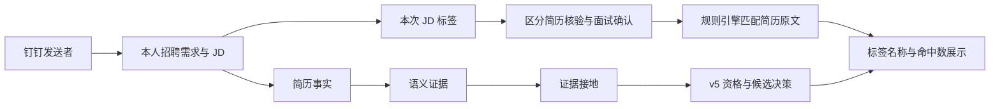

# Recruiter-Na

<div align="center">

**招聘娜｜用人部门招聘助手**

**把用人需求整理成 JD，把候选依据说清楚。**

钉钉用人部门招聘助手 · Codex Harness · 有证据的候选决策

**中文** | [English](README.en.md)

**v0.2.1 · 开发者预览 · 支持个人测试环境验证**

</div>

招聘娜面向用人部门，支持发起、补充和继续**本人**招聘需求，以及查看**本人**需求进展。命中已核验画像后只补充本次增量要求；岗位画像、策略和简历库在后台使用。

公开源码版本由 `RELEASE_VERSION` 标识（0.2.1）；`VERSION` 保留工作流合同版本 5.0.2。两者不混用。

公开仓库只提供代码，不包含生产凭据、租户配置、候选人简历、内部岗位/JD 库、工单数据库或另行授权的 IM adapter。源码测试通过、服务启动、机器人收到了消息与真实业务验收分别记录。

## 核心能力与边界

| 能力 | 当前实现与边界 |
|---|---|
| 招聘需求与 JD | 语义匹配已核验画像；模板只作措辞参考，不增加硬条件 |
| 简历阶段标签 | 从本次 JD 提取能力/经验，由现有规则引擎匹配原文；只统计本阶段可核验项 |
| 面试确认项 | 单列面试重点，不进入简历阶段标签分子、分母 |
| 资格与候选决策 | v5 证据接地后确定性判定；正式支持检验技术员应届/社招，其他岗位不回退旧评分 |
| 推荐与换批 | 每批 3 人，沿同一顺序快照继续，不重复；耗尽后等待 HR 寻源 |
| 权限 | 招聘工单读写以钉钉发送者身份限定到本人 |
| 简历交付 | 依赖合法源文件与钉钉业务回执；无回执不宣称发送成功 |
| 外呼联系 | 尚未接入正式外呼闭环，联系意向不代表已拨号 |

## 本次修复：为什么应显示 3/3，而不是 3/9

若 JD 共 9 项，但其中 6 项只能在面试确认，则简历阶段只有 3 项可核验。三项全部命中时显示：

```text
简历阶段符合标签：3/3（规范操作与执行能力、检验科经验、人员带教经验）
```

另外 6 项留在面试确认项中。面试重点展示为“提问方向（标签）”，复用判据描述，不重复列出“简历未提及”。若这 3 项里只找到 1 项证据，则显示 **1/3**；简历没写不等于不会，也不通过缩小分母来凑满分。标签数由实际 JD 及本阶段适用范围决定，不固定为 3、7、8 或 9。

学历、证书、工作地点单独展示。具备报考资格或已报名待考均不等于已持证。未知信息进入待核实，不直接淘汰。标签是证据覆盖提示，不是客观人才分数，也不覆盖 v5 决策。

**历史推荐快照保留原值，需重新筛选后才使用新口径。** 已有 JD 的确认摘要在重新整理 JD 后更新。

## 技术架构



卡片标签匹配、v5 决策、推荐顺序分别保留追溯数据；辅助匹配引擎的资格提示和推荐结论不覆盖 v5。活跃入口为 `resume_screening/decision/screening_v5.py`；legacy 历史评分模块仅用于回归与回滚分析，不由公开用人部门链路加载。详细模块说明见 [resume_screening](runtime/rn/resume_screening/README.md)。

## 快速开始

需要 Python 3.10+；启动钉钉桥还需要 Node.js 20+、Codex CLI 及合法取得的 IM adapter。公开代码可先做源码级验证：

```bash
git clone https://github.com/leonleiwang/recruiter-na-codexharness.git
cd recruiter-na-codexharness
python3 -m venv .venv
source .venv/bin/activate
python -m pip install -r requirements.txt
python scripts/secret_scan.py
PYTHONPATH=runtime python -m pytest tests/test_secrets_and_privacy.py tests/test_codex_packaging.py -q
```

Windows 可用 `.venv\Scripts\activate`。新环境使用示例配置，已有配置请保留；凭据只写入未跟踪的本地文件。上述命令不启动真实机器人，也不读取生产 MySQL。

## 配置与运行

| 配置/入口 | 用途 |
|---|---|
| [环境变量示例](deploy/recruiter-na.env.example) | 钉钉、模型路由、数据源及工单路径；只在部署环境填写实际值 |
| `config/codex/*.example` | 隔离的 Codex 模型配置，复制到指定 `CODEX_HOME` |
| `RECRUITER_REQUEST_DB` | 本人的招聘需求通过 owner 权限校验后写入 SQLite |
| `RESUME_BACKEND` / `RESUME_JSONL_PATH` | 授权的简历后端；个人测试优先用合成 JSONL |
| `RECRUITER_RESUME_SOURCE_ROOTS` | 简历原件交付白名单根目录，未配置则不能交付原件 |
| [安装脚本](deploy/install-cloud.sh) | 新环境安装参考；已有服务器升级需先确认实例并备份 |
| [服务单元](deploy/recruiter-na.service) | systemd 运行入口；实际部署可能有实例覆盖配置 |

真实运行还需运营方提供合法简历、已核验岗位/JD 材料和私有 adapter。公开源码不授予这些材料或依赖的使用权。

## 开发与验证

```bash
PYTHONPATH=runtime python -m pytest tests/test_readable_hiring_tags.py tests/test_screening_v5.py -q
node --test im/*.test.mjs
python -m compileall -q runtime/rn scripts
python scripts/secret_scan.py
```

`bash scripts/verify.sh` 是完整运维验证入口，依赖私有 adapter、授权的数据基础和可用解析/OCR 环境。公共源码副本不保证全量测试全绿；必须区分测试回归、缺失材料和环境失败。精确验证结果见 [v0.2.1 发布说明](docs/releases/v0.2.1.md)。

## 安全与贡献

敏感属性不得进入候选决策或推荐顺序；工单操作必须 owner-scoped。不要提交简历、工单数据库、密钥、截图或真实导出包。问题报告请使用合成样本，安全问题按 [安全说明](SECURITY.md) 私下反馈。

保留贡献者原始提交与作者信息；代码修复、源码发布、测试实例部署和业务验收分开记录。详见 [贡献约定](CONTRIBUTING.md)。

## 项目文档

- [使用说明](USAGE.md) · [Candidate Decision 合同](docs/RECRUITMENT_DECISION_V5.md)
- [解析与匹配引擎](runtime/rn/resume_screening/README.md) · [更新日志](CHANGELOG.md)
- [版本说明索引](docs/releases/README.md) · [English](README.en.md)

## 更新历史

- **v0.2.1**：简历阶段分母、JD 标签卡片、资格展示修复、中文默认文档与发布材料。
- **v0.2.0**：JD 生成、上传解析与标签匹配；已有源码 tag，不能据此推断已部署。
- **v0.1.0**：早期源码发行；后续 v5 工作流版本与公开源码 tag 分开管理。

更早的实现记录保留在 [CHANGELOG](CHANGELOG.md)，不补造不存在的历史分支或验收。

## 许可证

[Apache-2.0](LICENSE) 仅适用于本仓库实际分发的文件，不涵盖被排除的私有数据、租户配置或另行取得的运行依赖。
